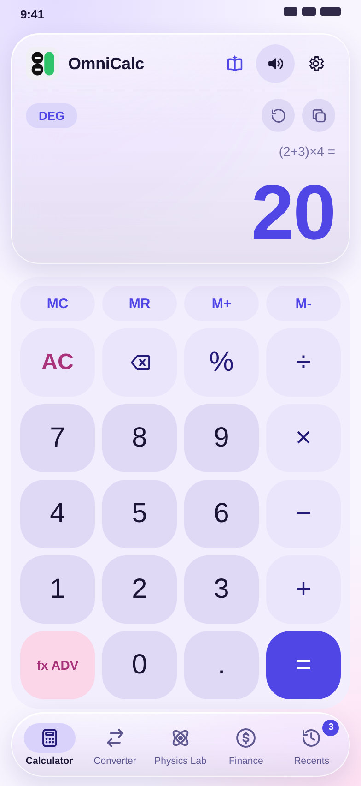
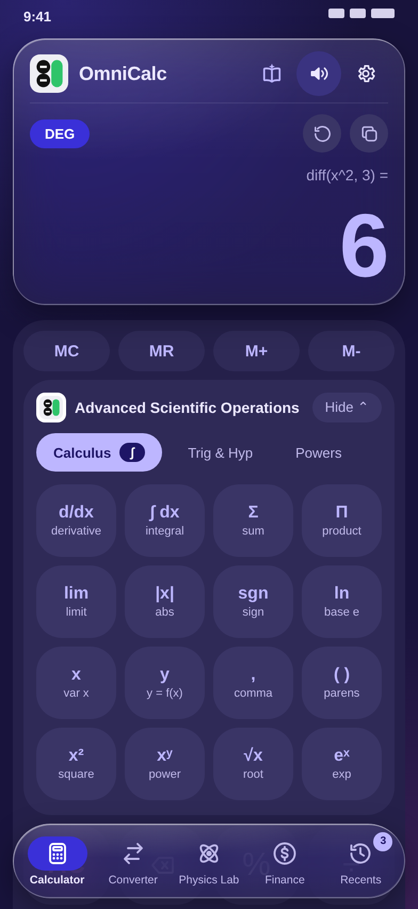
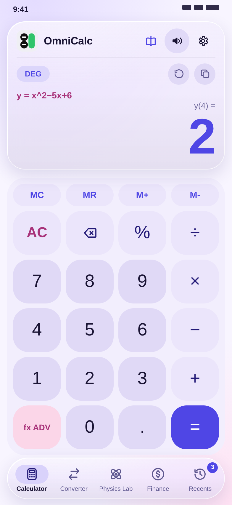
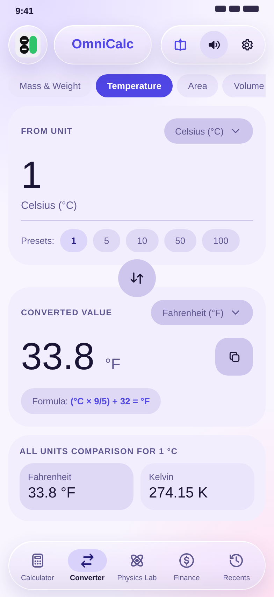
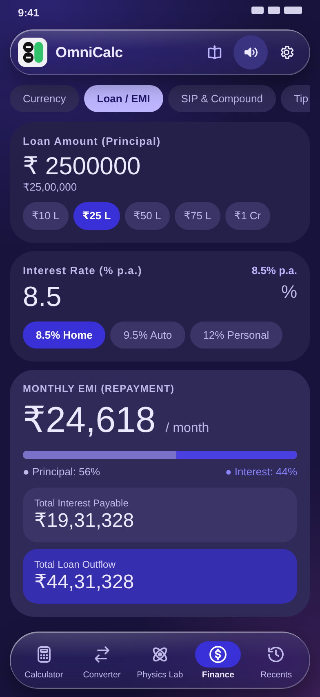
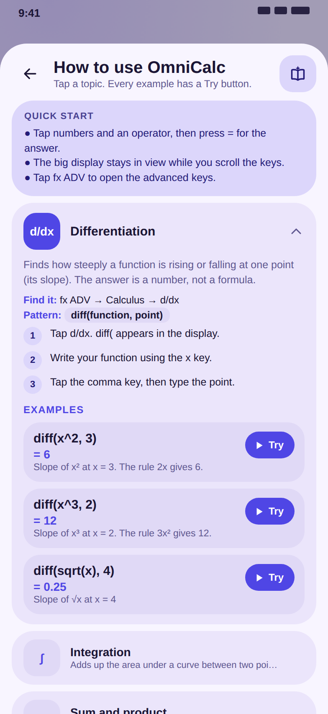
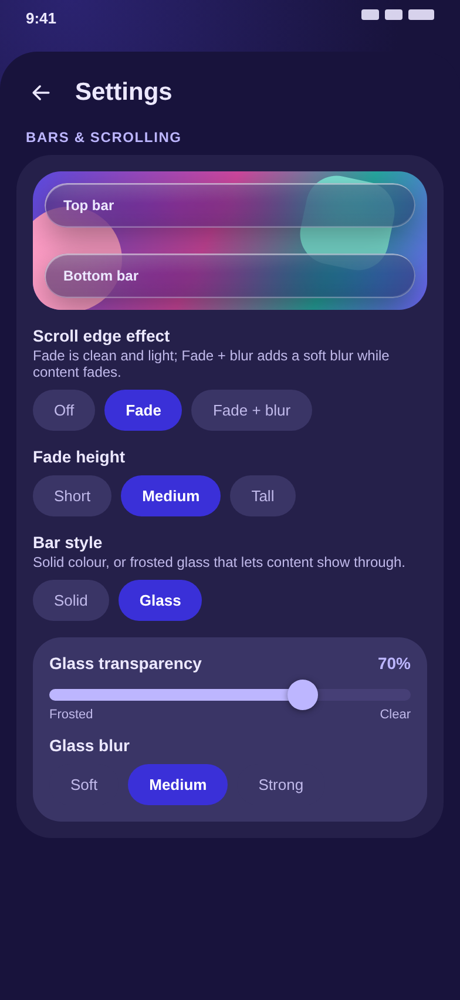

# OmniCalc

**A calculator suite for scientists, engineers, students and everyday money maths** — standard and scientific calculator, unit converter, finance tools, a physics lab and an optional function grapher, in one offline-capable app. Ships as a native Android app (Capacitor) and also runs in a browser.

- **App ID:** `com.saketh.omnicalc`
- **Stack:** React 19 · Vite · TypeScript · Tailwind CSS 4 · Capacitor (Android)

---

## Screenshots

<!-- Placeholder renders of the app's screens. To use real ones, take screenshots on your phone and replace the files in docs/screenshots/ (same names). -->
<p align="center">
  
  
  
  
</p>
<p align="center">
  
  
  
</p>

*Calculator with the answer display pinned at the top, advanced calculus keys, `y = f(x)` equations, the unit converter with its collapsing header, the Loan / EMI calculator, the built-in user guide, and the glass and scroll-edge settings.*

---

## Features

### Calculator (Standard & Scientific)
- Expression evaluator with trigonometric, inverse trig, hyperbolic, `ln`, `log`, `exp` and `sqrt` functions
- Calculus and discrete functions: `diff`, `integrate`, `sum`, `prod`, `limit`, `root`, `gcd`, `lcm`, `mod`, `min`, `max`, `avg`
- Combinatorics: `nCr` and `nPr`, including infix form (`10 nCr 3`, `17 mod 5`)
- Percent works like a handheld calculator: `200×15%` is 30, `200+10%` is 220
- Equations with `y`: write `y=x^2−5x+6`, press `=`, then type any x to get y
- Large answer display pinned at the top; the advanced keys scroll underneath it, and long expressions shrink to fit
- Degree / radian angle modes and configurable decimal precision
- Persistent history tape
- Built-in user guide (book icon in the header) with a *Try* button on every example

### Unit Converter
Length, Mass & Weight, Temperature, Area, Volume, Speed, Digital Data and Time (plus further categories in `src/engine/units.ts`).

### Finance
| Tab | What it does |
| --- | --- |
| Currency | Live exchange rates with a cached / offline fallback |
| Loan / EMI | Monthly payment, total interest, full amortisation schedule |
| SIP & Compound | SIP and compound growth with annual step-up and yearly breakdown |
| Tip | Bill splitting and tip calculation |
| ROI & CAGR | Return on investment and compound annual growth rate |

### Physics Lab
- **Constants:** fundamental constants grouped by Universal, Mechanics, Electromagnetism, Quantum & Atomic, Thermodynamics and Astrophysics
- **Solvers:** Kinematics & Projectiles, Special Relativity, Quantum & Waves, Electromagnetism

### Grapher (optional)
Canvas-based function plotter with pan, zoom and reset. Disabled by default; enable it in **Settings**.

### Experience
- Material 3 Expressive theming: Iris, Oceanic, Botanical Sage, Sunset Terracotta and AMOLED
- System / light / dark colour mode
- Liquid-glass or solid floating bars, soft scroll-edge fade and blur, and a header that splits into a logo, a name pill and an action pill as you scroll
- Key-click sounds (generated with Web Audio) and haptic feedback
- Swipeable tabs, responsive layout (bottom nav on phones, navigation rail on larger screens)
- The back gesture steps back through your screens
- Settings and history saved locally on the device

---

## Download

Get the latest signed APK from the [**Releases**](https://github.com/adssaketh/OmniCalc/releases) page. If you have an older debug build installed, uninstall it first: Android will not install over a build signed with a different key.


## Project Structure
```
├── src/
│   ├── App.tsx            # App shell, floating bars, scroll-edge fade, settings and history state
│   ├── edgeEffects.ts     # Scroll-edge fade / blur geometry and glass settings
│   ├── guideContent.ts    # Text and examples of the in-app user guide
│   ├── version.ts         # App version shown in Settings
│   ├── navigation.ts      # Shared destinations for the bottom bar and the rail
│   ├── motion.ts          # Shared spring / easing presets
│   ├── components/        # Screens (Calculator, Converter, Finance, Physics, Graph), Sheet, settings, navigation
│   ├── engine/            # evaluator, units, finance, physics, currency logic
│   ├── hooks/             # theme, orientation
│   ├── utils/audio.ts     # Key-click sounds
│   └── types/             # Shared TypeScript types
├── public/                # icons, privacy policy
├── android/               # Capacitor Android project
├── assets/                # Icon and splash source images
├── .github/workflows/     # CI: debug + signed release APK, GitHub Releases
├── RELEASE_NOTES.md       # Description used for the GitHub Release
├── LICENSE                # GNU General Public License v3.0
├── capacitor.config.json
└── vite.config.ts
```

---

## Privacy
No microphone, camera, contacts or location access is requested. Currency rates are fetched from public exchange-rate APIs when online. See `public/privacy-policy.html`.

## License
OmniCalc is free software, licensed under the [GNU General Public License v3.0](./LICENSE). Copyright (C) 2026 Saketh. You may use, study, share and change it; if you share a changed version you must share its source under the same license. A few files that came from Google's AI Studio template keep their original Apache-2.0 notice, which is compatible with the GPL.

## Author
Built by **Saketh** ([@adssaketh](https://github.com/adssaketh)).
